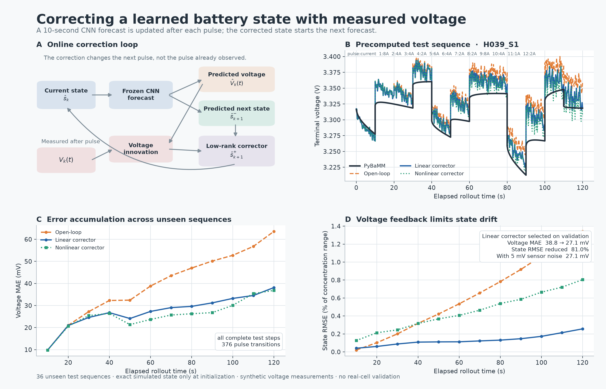

# Online voltage-based state correction



## Question

The one-step CNN is accurate when its input state is supplied by PyBaMM, but recursive use feeds each predicted concentration profile into the next forecast. Small state errors then accumulate. This extension asks a focused question:

> After each 10-second pulse, can the measured terminal-voltage residual correct the CNN's predicted concentration state before the next pulse?

This is an online drift-correction experiment. It does not infer an unknown battery state from an arbitrary current-voltage history: the exact simulated state is used once, at sequence initialization. Thereafter the rollout uses only the corrected CNN state, applied current, and voltage observed during each completed pulse.

## Method

For pulse (k), the frozen CNN produces a voltage trajectory and a prior next-state estimate,

\[
(\hat V_k(t),\hat s^-_{k+1})=F_\theta(\hat s^+_k,I_k).
\]

After the pulse, the full 41-point voltage measurement gives the innovation

\[
e_k(t)=V_k^{\mathrm{meas}}(t)-\hat V_k(t).
\]

A corrector predicts a low-rank state update from the innovation, predicted state, and current:

\[
\hat s^+_{k+1}=\operatorname{clip}\!\left(
\hat s^-_{k+1}+B\,g_\phi(e_k,\hat s^-_{k+1},I_k),0,1
\right).
\]

Here (B) is a 16-component PCA basis fitted only to training-state errors. Two versions of (g_\phi) use identical inputs and examples: a multi-output Ridge regression and a small MLP with hidden widths 128 and 64. The term *Kalman-style* describes the forecast/innovation/update structure; no covariance propagation or Kalman gain is used.

The frozen CNN and the original 48/12/12 history split are retained. Three deterministic current sequences of up to 12 pulses were simulated for every history, giving 216 sequences. Physical cutoff ends a sequence; no targets are padded or extrapolated beyond the event. The resulting dataset contains 2,250 complete transitions, 46 physical cutoffs, and no solver failures. The held-out test set contains 36 sequences, 376 complete transitions, and 7 cutoff attempts.

Scaling and PCA use training sequences only. Ridge alpha and MLP checkpoints use validation sequences only. The test set is evaluated once under clean, 2 mV, and 5 mV independent Gaussian voltage noise. The linear corrector has the lowest validation posterior-state RMSE and is therefore the frozen primary corrector.

## Results

| Unseen-test result | Open-loop CNN | Linear corrector | Nonlinear corrector, seed 42 |
|---|---:|---:|---:|
| Voltage MAE, clean measurement | 38.76 mV | **27.06 mV** | 25.35 mV |
| Posterior-state RMSE, clean measurement | 0.00737 | **0.00140** | 0.00488 |
| Voltage MAE with 5 mV measurement noise | 38.76 mV | **27.08 mV** | 25.24 mV |
| Infeasible attempts predicted feasible, clean | 4 / 7 | **3 / 7** | 3 / 7 |
| State values clipped to physical range | 0% | 0% | 0% |

The validation-selected linear corrector reduces overall voltage MAE by **30.2%** and posterior-state RMSE by **81.0%** relative to the open-loop rollout. At the twelfth pulse, the open-loop voltage MAE is 63.60 mV and the corrected value is 38.14 mV; posterior-state RMSE falls from 0.01342 to 0.00256. The correction-only median latency is 0.059 ms on the recorded Apple arm64 CPU run.

The nonlinear corrector obtains a lower clean test voltage MAE than the linear model, but it has more than three times the state RMSE and did not win validation selection. It is reported rather than promoted after seeing the test set. The three nonlinear seeds also vary in posterior-state RMSE, from 0.00450 to 0.00646 on clean test data.

The result supports a precise claim: voltage feedback can reduce recursive surrogate drift in this synthetic SPM setting. It does not establish full state observability, real-cell performance, safety, or P2D/SOH adaptation. Only seven test cutoff events occurred, so the change from four to three false-feasible classifications is descriptive rather than strong evidence of improved cutoff detection.

[Open the interactive precomputed rollout](figures/online_correction_browser.html). It uses the Plotly CDN and needs internet access when opened. It displays saved results and does not perform browser-side inference.

## Reproduce

Run after completing the base experiment:

```bash
python src/generate_correction_data.py
python src/train_correction.py
python src/evaluate_correction.py
python src/plot_correction.py
python src/verify_correction.py
```

`generate_correction_data.py` refuses to overwrite its local dataset. Full arrays, checkpoints, and training logs remain under the ignored `local/` directory. The static figure and interactive HTML can be rebuilt from tracked result tables alone:

```bash
python src/plot_correction.py
```

The frozen extension settings are in `correction_config.json`; sequence membership and event status are recorded in `results/correction_sequence_manifest.csv` and `results/correction_step_manifest.csv`.

