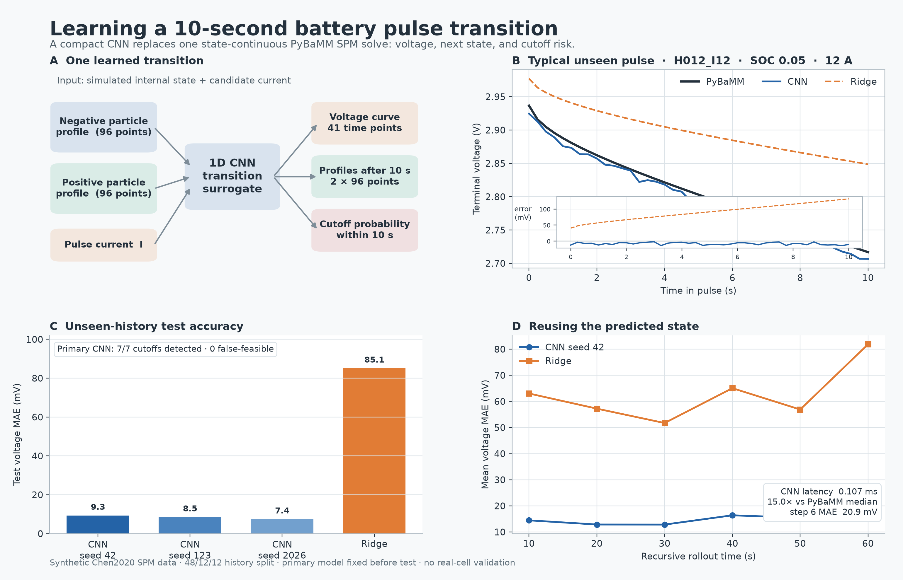

# Learning a 10-second battery pulse transition



This project trains a compact 1D convolutional neural network (CNN) to replace **one 10-second PyBaMM Single Particle Model (SPM) solve**. Given the lithium concentration profiles inside the negative and positive representative particles and a candidate discharge current, the network predicts:

1. the 41-point terminal-voltage trajectory over the next 10 seconds;
2. both concentration profiles after 10 seconds; and
3. whether PyBaMM would reach its physical voltage cutoff before 10 seconds.

In mathematical shorthand, the learned transition is

\[
\left(c_n(r,0),c_p(r,0),I\right)
\longmapsto
\left(V(t),c_n(r,10),c_p(r,10),p_{\mathrm{cutoff}}\right).
\]

The project is a small, reproducible analogue of learned electrochemical-model time steppers. It is inspired by McKay, Gopaluni, and Wetton's SPM and P2D surrogate work; it is not a reproduction of their full P2D study.

## Results

The frozen primary model is CNN seed 42. All model and threshold choices used the validation set; the test set contains 12 previously unseen preparation histories.

| Test result | Primary CNN | Ridge baseline |
|---|---:|---:|
| Voltage MAE on 89 complete pulses | **9.32 mV** | 85.06 mV |
| Maximum pointwise absolute voltage error | 73.80 mV | 438.56 mV |
| 10-second endpoint MAE | 10.38 mV | 92.69 mV |
| Minimum-voltage MAE | 13.36 mV | 92.80 mV |
| Maximum voltage overprediction | 26.36 mV | 438.56 mV |
| Final-state stoichiometry RMSE | 2.98e-4 | 6.44e-5 |
| Physical cutoffs detected | **7 / 7** | 7 / 7 |
| Infeasible pulses predicted feasible | **0 / 7** | 0 / 7 |
| Correct maximum feasible candidate current | **12 / 12 histories** | 11 / 12 histories |

Across the three fixed CNN training seeds, test voltage MAE was 8.40 ± 0.78 mV (population standard deviation). The primary seed was fixed in the configuration before testing and was not replaced by the best test seed.

When the predicted state was fed back recursively through six consecutive pulses, the primary CNN's mean voltage MAE increased from 14.45 mV at the first step to 20.85 mV at 60 seconds. This experiment exposes accumulated state error instead of evaluating only teacher-forced one-step predictions. Ridge reached 81.86 mV at the sixth step.

On the recorded Apple arm64 CPU run, the primary CNN took 0.107 ms per warm single-sample transition versus 1.599 ms for the median PyBaMM solver step, a measured **15.0× speedup**. Proxy timing includes normalization, inference, and output de-normalization. PyBaMM timing includes `solver.step` but excludes model construction and preparation-history simulation. This is a local microbenchmark, not a hardware-independent performance claim; SPM is already a small model.

[Open the interactive precomputed result browser](figures/interactive_test_browser.html). It contains all eight candidate currents for three reproducibly selected test histories: the median-error example, the worst-error example, and the history with the most physical cutoffs. It uses the Plotly CDN and therefore needs internet access when opened. It does not run the model in the browser.

## Online state correction extension

The recursive experiment motivated a second, frozen study: after every completed pulse, use the measured voltage innovation to correct the CNN's predicted concentration state before forecasting the next pulse. The exact simulated state is supplied only at sequence initialization.

On 36 unseen test sequences containing 376 complete transitions, the validation-selected linear corrector reduced voltage MAE from 38.76 to **27.06 mV** and state RMSE from 0.00737 to **0.00140**. With 5 mV simulated measurement noise, corrected voltage MAE was 27.08 mV. A nonlinear corrector reached a lower test voltage MAE but produced a larger state error and did not win validation selection.

[Read the complete online-correction experiment](ONLINE_CORRECTION.md) or [open its interactive precomputed rollout](figures/online_correction_browser.html). The extension preserves the original one-step baseline and reports its negative and favorable results separately.

## Physics and data

PyBaMM 26.4.2 provides the reference SPM with the Chen2020 parameter set, fixed temperature 298.15 K, and no aging. The SPM evolves radial solid-phase diffusion in one representative particle per electrode and computes terminal voltage from the electrochemical state. The solver uses IDAKLU with relative and absolute tolerances of 1e-8, 96 radial nodes per particle, and 16 through-cell points where required by PyBaMM.

Seventy-two independent, piecewise-constant discharge/rest histories create nonuniform internal states over a target SOC range of 0.01–0.90. Every terminal history state branches into the same candidate-current list: 0.5, 1, 2, 4, 6, 8, 12, and 16 A. The resulting 576 branches are split by complete history:

| Split | Histories | Complete pulses | Physical cutoffs | Solver failures |
|---|---:|---:|---:|---:|
| Train | 48 | 359 | 25 | 0 |
| Validation | 12 | 88 | 8 | 0 |
| Test | 12 | 89 | 7 | 0 |

Every time point, current branch, and derived sample from one history remains in the same split. Scaling statistics use training data only. PyBaMM's Chen2020 lower-voltage cutoff is 2.5 V. A cutoff branch is used for classification but never receives padded or extrapolated 10-second regression targets. Numerical solver failures have their own status and are not treated as physical infeasibility; none occurred in this run.

The CNN encodes the two 96-point profiles with three 1D convolutional layers, appends the normalized current, and uses separate voltage, state-increment, and cutoff heads. A standardized multi-output Ridge regression and logistic classifier use the same profiles, current, training histories, and regression targets. Ridge's smaller state RMSE but much larger voltage error is physically plausible: small concentration-profile errors can produce large voltage errors in steep open-circuit-potential regions, and a globally linear map cannot represent that voltage nonlinearity well.

## Reproduce

Python 3.12 was used. From this directory:

```bash
python3.12 -m venv .venv
source .venv/bin/activate
python -m pip install -r requirements.txt

python src/generate.py
python src/train.py
python src/evaluate.py
python src/plot.py
python src/verify.py

# Online-correction extension, after the base experiment
python src/generate_correction_data.py
python src/train_correction.py
python src/evaluate_correction.py
python src/plot_correction.py
python src/verify_correction.py
```

`generate.py` refuses to overwrite an existing local dataset. Move an existing `local/` directory to an archive location before intentionally starting a fresh run. The complete recorded run took about 18 seconds for data generation and 141 seconds for the three CNN fits on the development machine.

To rebuild all figures without the simulation data or checkpoints, install the plotting dependencies and run:

```bash
python src/plot.py
python src/plot_correction.py
```

The plotting scripts read only tracked CSV/JSON result tables. `config.json` freezes the base experiment and `correction_config.json` freezes the extension. `split_manifest.csv` records the shared history-level split; the metadata files under `results/` record actual package versions, solver settings, counts, and configuration hashes.

## Repository contents

Tracked files contain source code, two experiment configurations, environment pins, split and result summaries, compact display data, overview PNGs, and interactive HTML files. `.gitignore` excludes the full simulation arrays, training arrays, checkpoints, training logs, and cached files under `local/`. These local artifacts are retained on the development machine but should not be committed.

## Limits

This is a synthetic fixed-parameter SPM experiment. The internal concentration profiles are taken directly from simulation. A real battery does not expose these profiles to sensors. The extension corrects recursive drift from voltage feedback but still requires an exact simulated state at rollout initialization; arbitrary-time state initialization is not studied. The project does not validate against a real cell, model thermal effects or aging, estimate state of health, reproduce the P2D paper, certify safety, or establish speed on embedded hardware. Cutoff performance is based on only seven test cutoffs in each study and should be read as a small controlled result.

## References

- Sulzer et al. introduce the PyBaMM software used for every reference solve: [doi:10.5334/jors.309](https://doi.org/10.5334/jors.309).
- Chen et al. provide the LG M50 parameterization distributed as `Chen2020`: [doi:10.1149/1945-7111/ab9050](https://doi.org/10.1149/1945-7111/ab9050).
- McKay, Wetton, and Gopaluni demonstrate an early learned SPM surrogate and motivate the transition-learning setup: [doi:10.1016/j.ifacol.2021.08.225](https://doi.org/10.1016/j.ifacol.2021.08.225).
- McKay, Gopaluni, and Wetton extend the idea to a CNN surrogate for the P2D model with state-of-health adaptation: [doi:10.1016/j.engappai.2025.113178](https://doi.org/10.1016/j.engappai.2025.113178).

Verified BibTeX entries are in [`references.bib`](references.bib).
